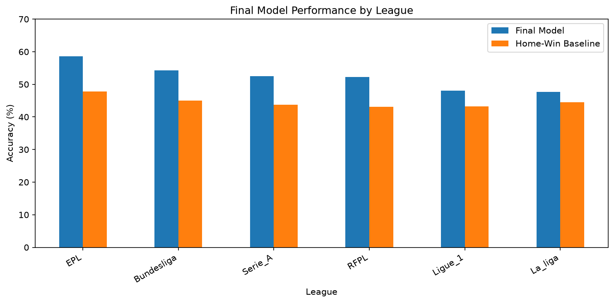

# Football Match Outcome Prediction with xG and Elo

A data science project exploring whether recent form, expected goals (xG), league position, and historical Elo ratings can help predict football match outcomes: **home win, draw, or away win**.

The focus is on building features available **before kickoff**, comparing predictive approaches, and evaluating the selected model on a later, unseen season.

## Dataset

- **Source:** [Football Data: Expected Goals and Other Metrics (Kaggle)](https://www.kaggle.com/datasets/slehkyi/extended-football-stats-for-european-leagues-xg)
- **Coverage:** Six European football leagues, 2014/15–2018/19 seasons
- **Match-level records:** 10,330 matches after merging home and away team observations
- **Target:** `w` (home win), `d` (draw), or `l` (away win)

The original dataset contains separate records for each team's performance in a match. These are combined into one match-level record for prediction.

## Approach

### Feature engineering

All predictive features are constructed from information available prior to the match:

- **Recent form:** Rolling averages of points, goals scored, and goals conceded over the previous five matches
- **Expected performance:** Rolling xG, xG against, and expected points (xPTS)
- **League position:** Pre-match standings and differences between the two teams
- **Elo ratings:** Historical opponent-adjusted strength, updated chronologically after each result

### Modeling and validation

Logistic Regression models with standardized features were compared with a home-win baseline and alternative models, including Random Forest. Feature sets were expanded progressively to examine their contribution.

To avoid evaluating on the data used for model selection, the dataset was split chronologically:

| Split | Seasons | Purpose |
| --- | --- | --- |
| Training | 2014/15–2016/17 | Model fitting |
| Validation | 2017/18 | Model selection and Elo tuning |
| Test | 2018/19 | Final held-out evaluation |

The Elo experiment tested **16 combinations** of update factors (`K = 10, 20, 32, 40`) and home-advantage values (`0, 40, 65, 90`). The selected configuration was **K = 32** and **home advantage = 65**. The final model was retrained on the training and validation seasons together before test evaluation.

## Results

### Validation model comparison (2017/18)

| Model | Accuracy | Macro F1 | Log Loss |
| --- | ---: | ---: | ---: |
| Always predict home win (baseline) | 44.92% | — | — |
| Logistic Regression — Recent Form | 50.07% | 0.358 | 1.010 |
| Logistic Regression — Expected Performance | 51.05% | 0.366 | 1.002 |
| Logistic Regression — Combined | 51.73% | 0.376 | 0.998 |
| Logistic Regression — Combined + League Position | 51.82% | 0.380 | 0.991 |
| Random Forest — Combined | 51.00% | 0.363 | 1.001 |
| Logistic Regression — Combined + Elo (K=20, H=65) | 54.06% | 0.401 | 0.978 |
| **Logistic Regression — Combined + Tuned Elo (K=32, H=65)** | **54.25%** | **0.404** | **0.977** |

The comparison shows that adding strength-gap features and historical Elo ratings to the combined feature set improved validation accuracy from **51.82% to 54.25%**. Because strength gaps and Elo were introduced together in this comparison, the improvement cannot be attributed to Elo alone. Tuning the Elo parameters provided only a small additional gain over the initial configuration (54.06%). The leading parameter combinations performed nearly identically.

### Additional experiment: Promoted teams' Elo ratings

We tested a lower starting Elo (1400, 1450, or 1500) for promoted teams, identified as teams that were not in the same league in the previous season. Features, model, and Elo parameters were unchanged, and the comparison used the 2017/18 validation season only.

| Starting Elo for promoted teams | Accuracy | Log Loss |
| --- | ---: | ---: |
| Original (1500 for new teams only) | **54.25%** | 0.977 |
| 1400 | 53.91% | **0.974** |
| 1450 | 53.77% | 0.975 |
| 1500 | 53.82% | 0.976 |

The best variant did not improve accuracy (−0.34 percentage points, 7 fewer correct predictions out of 2,057), and Log Loss improved only marginally (0.977 → 0.974). We kept the simpler original Elo initialization.

### Final held-out test (2018/19)

| Metric | Result |
| --- | ---: |
| Accuracy | **52.14%** |
| Macro F1 | 0.386 |
| Log Loss | 0.984 |
| Always-predict-home-win baseline | 44.65% |
| Log Loss of predicting training outcome frequencies | 1.071 |
| Test matches | 2,056 |

The final model was retrained on the training and validation seasons together, then evaluated on the unseen 2018/19 season. It outperformed the test baseline by **7.49 percentage points** in accuracy. Validation performance was used for model selection; test results were not used to tune the model.

### Performance by league (2018/19 test season)

We also evaluated the final model separately for each league, without retraining or adjusting its parameters. The chart compares test accuracy with the home-win baseline in each league.



| League | Matches | Model accuracy | Home-win baseline |
| --- | ---: | ---: | ---: |
| English Premier League | 377 | **58.6%** | 47.7% |
| Bundesliga | 304 | 54.3% | 45.1% |
| Serie A | 379 | 52.5% | 43.8% |
| Russian Premier League | 239 | 52.3% | 43.1% |
| Ligue 1 | 379 | 48.0% | 43.3% |
| La Liga | 378 | 47.6% | 44.4% |

The **English Premier League had the highest test accuracy (58.6%)**, improving on its baseline by **10.9 percentage points**. The model outperformed the home-win baseline in all six leagues, but improvements varied considerably. Since these comparisons reflect a single test season, they do not establish that the model will consistently perform better in one league than another.

### Main limitation: draws

The final model predicted only **one draw** among 2,056 test matches and did not identify any of the **539 actual draws** correctly. The relatively modest Macro F1 score reflects this weakness. Accuracy alone does not fully describe performance across all three match outcomes.

### Other limitations

- **Elo cold start:** Teams that are new to the dataset start at 1500, while teams returning after relegation keep their previous rating.
- **Log Loss:** The final model's Log Loss (0.984) improves on simply predicting the training outcome frequencies (1.071), but the improvement in predicted probabilities is modest.

## Reproduce the analysis

Tested with Python 3.11.

1. Clone the repository and create a virtual environment:

   ```bash
   git clone https://github.com/b170om/football-xg-analysis.git
   cd football-xg-analysis
   python -m venv .venv
   source .venv/bin/activate        # macOS / Linux
   # .venv\Scripts\activate         # Windows
   ```

2. Install the dependencies (includes Jupyter):

   ```bash
   pip install -r requirements.txt
   ```

3. Create a `data/` folder in the project root, download `understat_per_game.csv` from the [Kaggle dataset](https://www.kaggle.com/datasets/slehkyi/extended-football-stats-for-european-leagues-xg), and place it at `data/understat_per_game.csv`.

4. Open the notebook and run all cells (Kernel → Restart & Run All):

   ```bash
   jupyter notebook notebooks/football_analysis.ipynb   # or: jupyter lab
   ```

The notebook uses paths relative to the `notebooks/` folder (`../data/understat_per_game.csv` and `../figures/`). Jupyter and VS Code set this automatically when the notebook is opened; if you run it another way, run it from the `notebooks/` directory.

## What I Learned

1. **Turning raw data into a modeling dataset:** The source data has one row per team per match, so I paired home and away records using league, date, goals, and xG, and verified that every match was paired exactly once (10,330 matches).

2. **Preventing data leakage:** Every feature had to be known before kickoff: rolling averages use `shift(1)`, league positions are recorded before each match day, Elo ratings are stored before each update, and the data is split chronologically with a test season used only once.

3. **Reading small differences honestly:** Many Elo configurations and the promoted-team experiment differed by only a few correct predictions out of about 2,000 matches. I learned to treat such differences as noise rather than as real improvements.

4. **Looking beyond accuracy:** Macro F1, Log Loss, and confusion matrices showed that the model almost never predicts draws, a limitation that accuracy alone hides.

## Potential next steps

Investigate goal-based models (for example, Poisson regression) and better treatment of draw probabilities. Any further model changes would require a new untouched evaluation period to provide an independent performance estimate.
